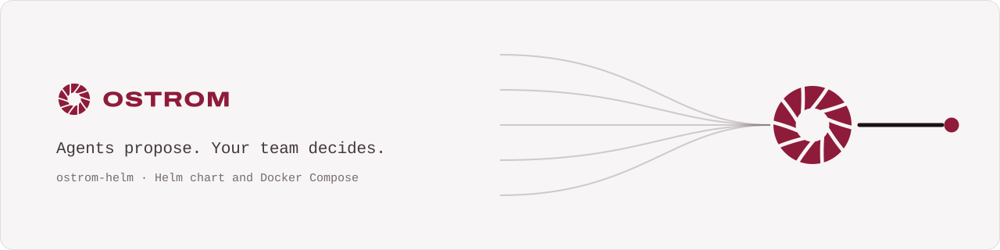
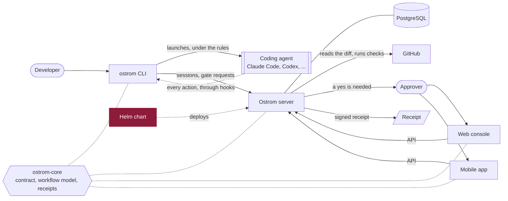

<p align="center">
  <a href="https://ostrom.run">
    <picture>
      <source media="(prefers-color-scheme: dark)" srcset=".github/assets/banner-dark.svg">
      
    </picture>
  </a>
</p>

<p align="center">
  <strong>Ostrom runs a company's AI coding agents in the cloud and makes them follow the team's rules.</strong><br>
  Every change they make leaves a receipt, and the few that matter wait for a person's yes.
</p>

<p align="center">
  <a href="https://ostrom.run">Website</a> ·
  <a href="https://ostrom.run/docs">Docs</a> ·
  <a href="https://github.com/ostrom-hq/ostrom-helm/discussions">Discussions</a> ·
  <a href="CONTRIBUTING.md">Contributing</a> ·
  <a href="SECURITY.md">Security</a>
</p>

<p align="center">
  <a href="https://github.com/ostrom-hq/ostrom-helm/actions/workflows/ci.yml"></a>
  <a href="LICENSE"></a>
  
</p>

## What this is

Everything to run Ostrom on your own infrastructure: the Helm chart `ostrom` for Kubernetes and a Docker Compose stack
for a single machine. Your code, your agents' work and your receipts stay on your servers.

| | |
|---|---|
| [`charts/ostrom`](charts/ostrom) | Server, web console, site, PostgreSQL, Ory Polis (SAML, coming soon: off by default), cloud-session controller RBAC, ingress, NetworkPolicy, HPA, PDB |
| [`compose/`](compose) | Self-hosting in one command: `./compose/install.sh` |
| [`docs/`](docs) | [Docker](docs/install-docker.md) · [Kubernetes](docs/install-kubernetes.md) · [Values](docs/values.md) · [Backup and restore](docs/backup-restore.md) · [Secret rotation](docs/secret-rotation.md) · [Upgrade](docs/upgrade.md) · [Sizing](docs/sizing.md) · [Images and signatures](docs/images.md) |

## Quick start

One machine with Docker Engine 24+ and Compose v2:

```sh
git clone https://github.com/ostrom-hq/ostrom-helm.git && cd ostrom-helm/compose
./install.sh          # then open http://app.localhost
```

On Kubernetes, follow [docs/install-kubernetes.md](docs/install-kubernetes.md).

## How it fits



## Security posture

The chart creates **namespaced objects only** (no ClusterRole, CRD, webhook or namespace; CI checks it), reuses the
cluster's ingress controller and, if present, cert-manager, and runs every pod non-root, without capabilities, with a
read-only root filesystem (except Ory Polis, whose Next.js runtime writes next to itself) under the `restricted` Pod
Security standard. Images and the chart are signed with cosign ([docs/images.md](docs/images.md)).

## Status

Ostrom is before its first public release.

| Part | Status |
| --- | --- |
| Helm chart and Compose stack, tested on every pull request | Available |
| Signed images on `docker.io/ostromhq` and OCI chart on `registry-1.docker.io/ostromhq` | Public |
| Public chart repository and release notes | At the launch |

## Tests

Every pull request runs `helm lint --strict`, `helm unittest`, kubeconform on Kubernetes 1.29 and 1.31, `ct install`
on kind (install, `helm test`, upgrade, uninstall) in a `restricted` namespace, and an end-to-end test of the Compose
install. See [`.github/workflows/ci.yml`](.github/workflows/ci.yml).

## Repositories

| Repository | What it is | License |
| --- | --- | --- |
| [ostrom-core](https://github.com/ostrom-hq/ostrom-core) | Shared Kotlin Multiplatform library: API contract, workflow model, signed receipts | Apache-2.0 |
| [ostrom-cli](https://github.com/ostrom-hq/ostrom-cli) | The `ostrom` command line: runs coding agents under the team's rules | Apache-2.0 |
| [ostrom-server](https://github.com/ostrom-hq/ostrom-server) | The server: gates, receipts, policies, the API | AGPL-3.0 + ee |
| [ostrom-web](https://github.com/ostrom-hq/ostrom-web) | The web console | AGPL-3.0 + ee |
| [ostrom-app](https://github.com/ostrom-hq/ostrom-app) | The iOS and Android app | AGPL-3.0 + ee |
| [ostrom-e2e](https://github.com/ostrom-hq/ostrom-e2e) | Full-stack end-to-end and load tests | Apache-2.0 |
| [ostrom-site](https://github.com/ostrom-hq/ostrom-site) | ostrom.run: website, documentation, blog | Apache-2.0 |
| **ostrom-helm** (this one) | Helm chart and Docker Compose for self-hosting | AGPL-3.0 |

## Contributing

Contributions are welcome. Read [CONTRIBUTING.md](CONTRIBUTING.md) (setup, tests, Conventional Commits, DCO), the
[Code of Conduct](CODE_OF_CONDUCT.md), and [SECURITY.md](SECURITY.md) to report a vulnerability privately. Questions
go to [Discussions](https://github.com/ostrom-hq/ostrom-helm/discussions); help options are in [SUPPORT.md](SUPPORT.md).

## License

GNU Affero General Public License v3.0, see [LICENSE](LICENSE).
